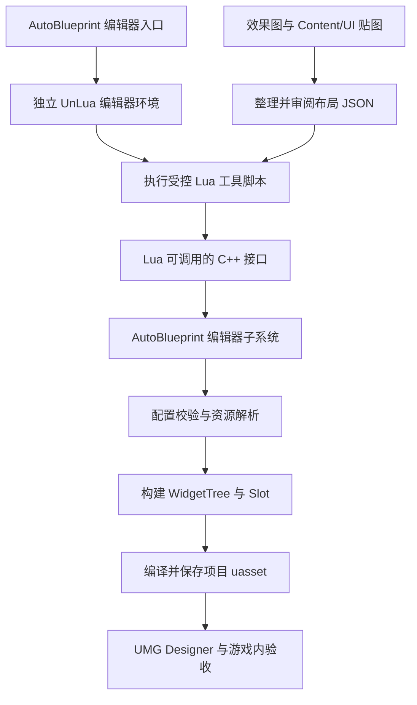

# AutoBlueprint 项目插件架构设计草案

本方案用于在 ProjectOne 项目内实现 AutoBlueprint 编辑器插件：通过 Lua + UnLua 调用 C++ 编辑器核心，把经过审阅的 JSON 布局配置转换为标准 User Widget Blueprint `.uasset`，在 UMG Designer 中打开即可查看和编辑控件树。目标版本为 UE 5.3.2、UnLua 2.3.6，首版以 Win64 Editor 为验证基线。版本为 0.2 草案，更新日期 2026-10-30；接口和示例均为拟定设计。

## 1 范围与待确认项

| 项目 | 当前约定 |
| --- | --- |
| 效果图解析 | 已确认：由我结合效果图和项目贴图整理布局 JSON；插件执行配置 |
| 脚本方案 | 已确认：Lua + 项目现有 UnLua，调用 C++ 编辑器核心 |
| 首版产出 | 控件树、布局、贴图、静态样式、变量命名；可预览并挂载 |
| 执行入口 | 编辑器中的 AutoBlueprint Lua 执行入口；无需启动 Play |
| 业务逻辑 | 后续接入，包括收银状态机、按钮业务事件的 UnLua 绑定和 Event Graph 生成 |
| 插件位置 | `ProjectOne/Plugins/AutoBlueprint/` |
| 资产位置 | 项目 `/Game/UI/...`，对应 `ProjectOne/Content/UI/...` |
| 重复生成 | 首版 CreateOnly；覆盖重建和保留人工修改的更新作为后续独立能力 |
| 本轮交付 | 架构、编码规范与开发计划；当前未开始插件实现 |

这里的“直接可用”指蓝图能够成功编译、保存、重新打开、实例化并通过 `AddToViewport` 显示。原生按钮可呈现常规交互样式，点击之后的游戏业务行为由后续逻辑实现。

## 2 工程依据与运行条件

工程的 `ProjectOne.uproject` 指向 UE 5.3，根目录 `README.md` 明确为 5.3.2，已有 UnLua 2.3.6。当前 `Content/UI` 下有 51 个 PNG、12 个 JPG，尚无 UI `.uasset`；资源和布局约定位于 `Content/UI/Cashier/Docs/`。这些图片需要导入为 Texture2D 后才能作为 UMG 资源引用。

项目设置 `bAuthorizeAutomaticWidgetVariableCreation=False`，因此插件必须按配置显式设置每个控件的 `is_variable`。现有 `.gitattributes` 已将 `.uasset` 纳入 Git LFS。

资产构建、蓝图编译和保存需要 UE 5.3.2 Editor。Lua 通过 UnLua 在 UE 编辑器进程内执行，并调用 AutoBlueprint 暴露的 C++ 接口；独立的 Lua 解释器不能替代引擎完成资产序列化。当前云端未提供 UE Editor，后续 C++ 编译及资产验收需在安装了 UE 5.3.2 的环境完成。

插件自有代码全部位于项目 Plugins 目录，依赖项目已有的 UnLua 插件；AutoBlueprint 不要求 PythonScriptPlugin。生成工具使用独立的编辑器 Lua 环境，避免依赖游戏默认 Lua 环境的启用状态。现有 UnLua 的默认启动流程与 PIE 有关联，因此“无需 Play 执行 Lua 并保存蓝图”必须在首个技术验证中确认。

## 3 总体架构



Lua 工具脚本负责组织调用、批处理和结果处理；C++ 负责配置文件读取、最终校验、资源解析、UObject 生命周期、控件树、Slot、编译与保存。JSON 仍是统一的布局数据格式，脚本语言替换不改变 `schema_version: 1` 的含义。Lua 通过反射接口调用 C++，不直接依赖 UMG 编辑器内部实现。

生成结果使用原生 `UUserWidget` 和原生 UMG 控件，引用项目的运行时资源。生成蓝图不得继承或引用 AutoBlueprintEditor 中的类，也不持有编辑器 Lua 环境。项目已有 UnLua 游戏逻辑独立保留；采用 Lua 作为生成工具不等于自动生成游戏事件绑定。

## 4 拟定代码目录

```text
ProjectOne/
├─ Plugins/
│  └─ AutoBlueprint/
│     ├─ AutoBlueprint.uplugin
│     ├─ Source/
│     │  └─ AutoBlueprintEditor/
│     │     ├─ AutoBlueprintEditor.Build.cs
│     │     ├─ Public/
│     │     │  ├─ AutoBlueprintSubsystem.h
│     │     │  ├─ AutoBlueprintLibrary.h
│     │     │  └─ AutoBlueprintTypes.h
│     │     └─ Private/
│     │        ├─ AutoBlueprintEditorModule.cpp
│     │        ├─ AutoBlueprintSubsystem.cpp
│     │        ├─ AutoBlueprintLibrary.cpp
│     │        ├─ Scripting/EditorLuaRunner.cpp
│     │        ├─ Layout/
│     │        │  ├─ LayoutSpec.h
│     │        │  ├─ LayoutParser.cpp
│     │        │  └─ LayoutValidator.cpp
│     │        ├─ Assets/
│     │        │  ├─ TextureAssetResolver.cpp
│     │        │  └─ WidgetBlueprintWriter.cpp
│     │        ├─ Widgets/
│     │        │  ├─ WidgetTypeRegistry.cpp
│     │        │  ├─ WidgetTreeBuilder.cpp
│     │        │  ├─ WidgetPropertyApplier.cpp
│     │        │  └─ WidgetSlotApplier.cpp
│     │        ├─ Diagnostics/BuildReport.cpp
│     │        └─ Tests/AutoBlueprintTests.cpp
│     ├─ Scripts/Lua/
│     │  ├─ AutoBlueprint/api.lua
│     │  └─ generate_from_file.lua
│     ├─ Resources/Schemas/layout.schema.json
│     ├─ Examples/cashier_example.layout.json
│     └─ Docs/
│        ├─ Architecture.md
│        ├─ constitution.md
│        └─ plan.md
├─ UIBlueprintLayouts/Cashier/main.layout.json
├─ Content/UI/Cashier/
│  ├─ Textures/
│  └─ WBP_CashierMain.uasset
└─ Saved/AutoBlueprint/Reports/
```

三份文档集中在 `Plugins/AutoBlueprint/Docs/`；上图其余插件源码与生成资产为计划项，尚未创建。Lua 工具脚本放在插件 `Scripts/Lua/` 下，由 EditorLuaRunner 显式加载；不放进项目默认会随游戏分发的 `Content/Script/`。项目专用布局配置放在 `UIBlueprintLayouts/` 并纳入版本控制；报告放在 Saved 下。业务 Widget 名称继续遵循现有 `WBP_CashierMain` 等约定。

## 5 模块职责与依赖

| 组件 | 职责 |
| --- | --- |
| 编辑器执行入口与 EditorLuaRunner | 在编辑器主线程创建任务专用 UnLua 环境、加载工具脚本、收集 Lua 错误并释放环境 |
| Lua 工具 API | 编排预检、构建及批处理；读取和传播结构化结果 |
| AutoBlueprintLibrary | 面向 Lua 的静态 UFUNCTION 门面；读取布局文件，检查执行状态并委托子系统 |
| AutoBlueprintSubsystem | 统一的 C++ 生成核心；协调阶段与结果，不依赖脚本语法 |
| LayoutParser 与 Validator | 解析版本化配置，检查树结构、属性、名称、路径及资源引用 |
| TextureAssetResolver | 复用已有 Texture2D，或导入明确指定的源图 |
| WidgetTypeRegistry 与构建处理器 | 集中登记控件能力；构建控件树并应用匹配的属性和 Slot |
| WidgetBlueprintWriter | 标记结构变更、编译、检查并保存 |
| BuildReport | 收集配置、Lua、编译和保存诊断，报告部分结果 |

设置一个 `Editor` 类型模块 `AutoBlueprintEditor`。基础依赖包括 `Core`、`CoreUObject`、`Engine`、`EditorSubsystem`、`UMG`、`SlateCore`、`UnrealEd`、`UMGEditor`、`AssetTools` 和 `Json`。UnLua 作为编辑器脚本宿主的模块依赖保持在 Private；定位插件脚本使用 `Projects`，编辑器菜单使用 `ToolMenus`，编译诊断及 Slate 依赖按实际 API 补充。Public 头文件只暴露 UE 类型和反射契约，避免泄露 Lua 状态指针。首版不操作 Event Graph，也不调用 UnLuaEditor 的私有实现。

```json
{
  "FileVersion": 3,
  "Version": 1,
  "VersionName": "0.1.0",
  "FriendlyName": "AutoBlueprint",
  "Description": "Generate Widget Blueprints from layout specifications through Lua and UnLua.",
  "Category": "Editor",
  "CanContainContent": false,
  "Modules": [
    {
      "Name": "AutoBlueprintEditor",
      "Type": "Editor",
      "LoadingPhase": "Default"
    }
  ],
  "Plugins": [
    {
      "Name": "UnLua",
      "Enabled": true
    }
  ]
}
```

上面是插件描述文件草案。实现时启用 AutoBlueprint，并核验 UnLua 的加载顺序及 Editor 目标行为。插件不自带运行时资产，因此 `CanContainContent=false`；Lua 源码由工具加载器读取。代码不修改 Engine 或 UnLua 源码来替代编辑器入口，不引入 Python 依赖。

## 6 布局配置协议

采用带 `schema_version` 的 JSON，Lua 和 C++ 共用同一套布局契约，不为每个界面定义独立 Schema。Lua 负责执行工具流程，JSON 负责描述界面；JSON Schema 提供基础类型约束，C++ 校验器负责最终的树结构与 UE 类型检查。此次替换脚本入口不改变布局协议版本。

| 字段 | 含义 |
| --- | --- |
| `asset.package_path` | UE 长包名，如 `/Game/UI/Cashier/WBP_CashierMain`，不含 `.uasset` 扩展名 |
| `design` | 布局参考宽高，用于设计预览和验收基线 |
| `resources` | 资源别名到源图导入目标，或到已有 UE 对象路径的映射 |
| `root` | 唯一根控件；包含类型、稳定名称、变量开关、属性和子节点 |
| `slot` | 子控件在父容器中的布局参数；根节点不填写 Slot |
| `properties` | 按控件类型定义的受支持属性，未知属性默认报错 |

以下示例使用仓库中已有的香蕉 PNG，展示图片与确认按钮的生成契约。它是协议示例，坐标与文案不代表任何尚未提供的目标效果图。

```json
{
  "schema_version": 1,
  "asset": {
    "package_path": "/Game/UI/Cashier/WBP_AutoBlueprintExample"
  },
  "design": {
    "width": 1080,
    "height": 1920
  },
  "resources": {
    "banana": {
      "source_file": "Content/UI/Cashier/Textures/Icons/A01_banana.png",
      "package_path": "/Game/UI/Cashier/Textures/Icons/T_A01_Banana"
    }
  },
  "root": {
    "name": "RootCanvas",
    "type": "CanvasPanel",
    "is_variable": false,
    "children": [
      {
        "name": "IMG_Product",
        "type": "Image",
        "is_variable": true,
        "slot": {
          "type": "Canvas",
          "anchors": {
            "min": [
              0,
              0
            ],
            "max": [
              0,
              0
            ]
          },
          "alignment": [
            0,
            0
          ],
          "offsets": [
            64,
            80,
            128,
            140
          ],
          "auto_size": false,
          "z_order": 0
        },
        "properties": {
          "brush": {
            "resource": "banana",
            "draw_as": "Image"
          },
          "visibility": "HitTestInvisible"
        }
      },
      {
        "name": "BTN_Confirm",
        "type": "Button",
        "is_variable": true,
        "slot": {
          "type": "Canvas",
          "anchors": {
            "min": [
              0,
              1
            ],
            "max": [
              1,
              1
            ]
          },
          "alignment": [
            0,
            1
          ],
          "offsets": [
            64,
            -80,
            64,
            120
          ],
          "auto_size": false,
          "z_order": 1
        },
        "properties": {
          "is_enabled": true,
          "is_focusable": true
        },
        "children": [
          {
            "name": "TXT_Confirm",
            "type": "TextBlock",
            "is_variable": true,
            "slot": {
              "type": "Button",
              "horizontal_alignment": "Center",
              "vertical_alignment": "Center",
              "padding": [
                12,
                8,
                12,
                8
              ]
            },
            "properties": {
              "text": "Confirm",
              "font_size": 32,
              "color": [
                1,
                1,
                1,
                1
              ],
              "visibility": "HitTestInvisible"
            }
          }
        ]
      }
    ]
  }
}
```

资源也可直接使用已有对象，例如 `"banana": {"object_path": "/Game/UI/Cashier/Textures/Icons/T_A01_Banana.T_A01_Banana"}`。每个资源条目在“已有对象”与“源图加导入目标”之间二选一。源图路径相对项目根目录解析；首版允许的导入源与目标范围为项目 `Content/UI` 和 `/Game/UI`。

Canvas 的 `offsets` 对应 `[Left, Top, Right, Bottom]`。某一轴锚点相同时，该轴后一个量表示尺寸；该轴锚点不同时则表示边距。示例图片采用左上固定锚点，按钮横向拉伸并距底部 80 个布局单位，高度为 120。`padding` 按 `[Left, Top, Right, Bottom]` 解释；颜色使用线性 RGBA 0～1，截图的 sRGB 颜色在整理配置时转换。

设计尺寸定义基准坐标，不自动保证任意设备的像素尺寸。运行时大小仍由视口、父容器和项目 DPI 规则共同决定。首版保留现有项目 DPI 设置，支持明确的锚点和容器布局；跨分辨率验收按选定的视口进行。

文本支持字号、颜色、对齐与已有字体资产引用。示例采用英文；实际中文界面需要指定包含中文字形的字体，并核验打包后的字形与换行。图片可设 Image 或 Box 画刷，Box 的九宫格边距使用归一化数值；保持宽高比可通过 ScaleBox 等显式容器表达。

## 7 首版控件与样式范围

| 类别 | 首版计划支持 |
| --- | --- |
| 面板 | CanvasPanel、Overlay、HorizontalBox、VerticalBox |
| 单子节点容器 | Border、SizeBox、ScaleBox、Button |
| 叶子控件 | Image、TextBlock、Spacer |
| 通用属性 | 名称、is_variable、可见性、启用状态、RenderOpacity |
| 常用布局 | Canvas 锚点与偏移、AutoSize、ZOrder；容器 Padding、Alignment、SizeRule |
| 图片与文字 | 画刷资源、颜色、Image/Box、九宫格边距；文字、字体、字号、对齐、自动换行 |
| 按钮 | Normal、Hovered、Pressed、Disabled 画刷及常规样式字段 |

每类 Slot 都由父控件决定。例如 CanvasPanel 的子节点使用 CanvasPanelSlot，VerticalBox 的子节点使用 VerticalBoxSlot，Button 只能有一个直接子节点。配置中父子关系与 Slot 类型不匹配时直接报错，不把 Canvas 的坐标字段套用到其他容器。

首版父类固定为原生 `UUserWidget`。继承已有 Widget Blueprint、自定义父类、嵌套其他 UserWidget、ListView 的条目生成、动画与状态切换列为后续扩展。

**焦点状态限制：**原生 Button 的 `FButtonStyle` 没有独立 Focused 画刷。项目素材的第五态不能直接作为同类样式写入。若配置请求 `focused` 画刷，首版返回不支持错误；后续可通过额外焦点控件和事件逻辑实现。开启 `is_focusable` 仅允许按钮获取焦点，不等于自动显示专用焦点贴图。

## 8 C++ 与 Lua 接口框架

C++ 核心仍由编辑器子系统提供 ValidateLayout 和 BuildWidgetBlueprint。面向 Lua 增加静态 UFUNCTION 门面 AutoBlueprintLibrary，提供文件入口并转调子系统。以下为接口设计示意；类型定义、桥接行为与 UE 5.3.2 编译验证在实施阶段完成。

```cpp
#pragma once

#include "CoreMinimal.h"
#include "EditorSubsystem.h"
#include "AutoBlueprintTypes.h"
#include "AutoBlueprintSubsystem.generated.h"

UCLASS()
class AUTOBLUEPRINTEDITOR_API UAutoBlueprintSubsystem
    : public UEditorSubsystem
{
    GENERATED_BODY()

public:
    UFUNCTION(BlueprintCallable, Category = "AutoBlueprint")
    FAutoBlueprintValidationResult ValidateLayout(
        const FString& LayoutJson);

    UFUNCTION(BlueprintCallable, Category = "AutoBlueprint")
    FAutoBlueprintBuildResult BuildWidgetBlueprint(
        const FString& LayoutJson,
        const FAutoBlueprintBuildOptions& Options);
};
```

Lua 通过 UnLua 调用下面的编辑器函数库；函数库只负责文件和执行入口，不复制子系统中的构建逻辑。

```cpp
#pragma once

#include "CoreMinimal.h"
#include "Kismet/BlueprintFunctionLibrary.h"
#include "AutoBlueprintTypes.h"
#include "AutoBlueprintLibrary.generated.h"

UCLASS()
class AUTOBLUEPRINTEDITOR_API UAutoBlueprintLibrary
    : public UBlueprintFunctionLibrary
{
    GENERATED_BODY()

public:
    UFUNCTION(BlueprintCallable, Category = "AutoBlueprint")
    static FAutoBlueprintValidationResult ValidateLayoutFile(
        const FString& ProjectRelativePath);

    UFUNCTION(BlueprintCallable, Category = "AutoBlueprint")
    static FAutoBlueprintBuildResult BuildFromLayoutFile(
        const FString& ProjectRelativePath,
        const FAutoBlueprintBuildOptions& Options);
};
```

| 反射类型 | C++ 和 Lua 使用的拟定字段 |
| --- | --- |
| `FAutoBlueprintDiagnostic` | Severity、Code、JsonPath、WidgetName、Message |
| `FAutoBlueprintValidationResult` | bValid、Diagnostics、PlannedImports、PlannedAssetPath |
| `FAutoBlueprintBuildOptions` | WritePolicy（默认 CreateOnly）、bSave（默认 true）、bOpenEditor（默认 false） |
| `FAutoBlueprintBuildResult` | bSuccess、bCompiled、bSaved、AssetPath、Diagnostics、CreatedAssets、SavedPackages、UnsavedPackages、ReportFile |
| `EAutoBlueprintWritePolicy` | 首版仅 CreateOnly；重建策略留待后续设计 |

返回类型使用 USTRUCT/UENUM 和 UPROPERTY，使 UnLua 能读取结果。Lua 访问反射字段保留 C++ 实际名称，例如 `result.bSuccess` 和 `options.bSave`；JSON 与磁盘报告继续使用约定的 `lower_snake_case` 字段。验证可读取文件、检查已有资产与资源类型，但不创建、导入或保存资产；构建时重新校验，避免预检与执行间状态变化。

```lua
-- 拟定用法：由 AutoBlueprint 的编辑器 Lua 入口执行。
-- 这些自定义接口需要完成插件实现与 UE 验证后才可调用。
local layoutPath = "UIBlueprintLayouts/Cashier/main.layout.json"

local function printDiagnostics(diagnostics)
    for _, item in ipairs(diagnostics:ToTable()) do
        print(item.Code .. ": " .. item.JsonPath .. ": " .. item.Message)
    end
end

local validation = UE.UAutoBlueprintLibrary.ValidateLayoutFile(layoutPath)
if not validation.bValid then
    printDiagnostics(validation.Diagnostics)
    error("Layout validation failed")
end

local options = UE.FAutoBlueprintBuildOptions()
options.WritePolicy = UE.EAutoBlueprintWritePolicy.CreateOnly
options.bSave = true
options.bOpenEditor = false

local result = UE.UAutoBlueprintLibrary.BuildFromLayoutFile(
    layoutPath, options
)
if not result.bSuccess then
    printDiagnostics(result.Diagnostics)
    error("Widget generation failed")
end

print("Generated: " .. result.AssetPath)
```

首版提供编辑器菜单或受控命令入口，由 EditorLuaRunner 按任务创建独立 `UnLua::FLuaEnv`，加载插件 `Scripts/Lua/` 下的工具脚本，配置局部模块查找路径，并在任务结束释放环境。不得依赖游戏 BeginPlay、全局切换 UnLua 游戏环境状态或执行项目默认 Lua 启动模块；初始化和关闭行为通过 P0 实测确认。

生成在普通编辑状态执行，无需启动 Play；PIE/SIE 期间的资产写入明确拒绝并返回 `EDITOR_BUSY`。Lua 脚本异常携带脚本位置与调用栈进入报告，布局 JSON 不作为可执行代码。UE 命令行执行 Lua 的宿主加载、参数和退出码属于后续适配；独立 Lua 不能离线写出有效 `.uasset`，无渲染运行不作为截图验收环境。

## 9 构建与保存流程

1. **只读预检。** 检查 schema 版本、包名、名称唯一性、节点数量及深度、唯一根、父子数量约束、Slot 类型、数值与枚举、资源别名和源文件。缺文件、LFS 指针代替图片、未知控件或属性均返回可定位错误。

2. **资源解析。** 加载并检查已有 Texture2D；按资源清单导入缺失图片。对新导入纹理设置 UI 所需的纹理分组和压缩等选项；已有纹理默认保持原设置。首版不隐式重新导入或覆盖同名纹理，冲突需在资源清单中改为明确复用或改名。

3. **创建资产。** 使用 UE 的 Widget Blueprint 创建流程，在指定包下创建 `UWidgetBlueprint`，父类为 `UUserWidget`。确保编辑器注册及对象标志正确。

4. **构建控件树。** 通过 WidgetTree 的构造接口创建节点，设置 `RootWidget`，添加子节点，并写入相应 Slot。控件由正确的 WidgetTree 持有；名称唯一，变量开关显式指定。

5. **应用属性与编译。** 写入资源、样式和属性，标记 Blueprint 结构变更，再使用 UE 蓝图编译流程。任何编译错误都阻止目标 Widget 资产保存，警告进入报告。

6. **保存与回报。** 按依赖关系保存纹理和 Widget 包，逐包检查结果并记录来源、schema 版本和报告。只有请求保存且所有必要包保存成功，Lua 结果才返回 `bSaved=true`；磁盘报告对应字段为 `saved=true`。

7. **重新打开验收。** 从磁盘重新加载或在新的编辑器会话打开，验证树、资源、变量与运行时实例化，而不是只检查文件是否存在。

底层将使用 UE 提供的 Widget Blueprint Factory、`UWidgetTree::ConstructWidget`、Panel 添加子节点、蓝图结构标记与编译、包保存等机制。具体 Factory 初始化、编译诊断读取、保存函数签名以 UE 5.3.2 头文件和编译结果为准。

整个 UObject 构建过程在编辑器主线程执行。独立 UI 预览采用正常图形编辑器，并与效果图在相同视口、DPI、字体和资源条件下比较。首版不会仅凭成功生成文件就声明视觉还原完成。

## 10 重复生成与失败处理

首版确定采用 CreateOnly。Lua 与 C++ 入口都遵守同一规则；切换脚本语言不增加覆盖资产的权限。

| 策略 | 行为 |
| --- | --- |
| CreateOnly | 首版默认且唯一的写入策略。目标存在即报 `ASSET_ALREADY_EXISTS`，不修改原资产 |
| 新名称生成 | 调用方指定新包名，如 `WBP_CashierMain_Review02`，保留旧版本作比较 |
| RebuildGenerated | 后续独立设计，不作为首版选项；需要明确覆盖及人工修改处理规则 |
| 任意已有蓝图增量修改 | 后续设计，涉及控件、动画、变量和 Event Graph 合并 |

如果启用 RebuildGenerated，必须检查来源记录、包是否有未保存修改，以及资产编辑器/预览实例状态，并明确处理重建会丢弃的人工修改。配置 hash 或 WidgetTree hash 不能证明资产完全未被人工修改；不能据此承诺保留 Event Graph、动画或绑定。该模式的详细覆盖规则需在实施前确认，首版默认路径始终为 CreateOnly。

预检失败不写资产。构建失败时，不保存编译失败的 Widget；但导入和多包保存可能已产生部分资源或留下未保存的包，报告必须列出这些结果。`FScopedTransaction` 用于适当的编辑器撤销记录，不能保证多个文件保存的原子性，也不等于磁盘回滚。首版不自动删除已有资产来恢复，不把临时包重命名视为无风险替换。

诊断包括布局和资源错误，以及 `LUA_ENV_INIT_FAILED`、`LUA_SCRIPT_FAILED`、`EDITOR_BUSY`、`UNSUPPORTED_WIDGET`、`INVALID_SLOT`、`DUPLICATE_WIDGET_NAME`、`MISSING_RESOURCE`、`LFS_SOURCE_NOT_MATERIALIZED`、`ASSET_ALREADY_EXISTS`、`UNSUPPORTED_FOCUS_BRUSH`、`BLUEPRINT_COMPILE_FAILED`、`PACKAGE_SAVE_FAILED`。诊断按需携带脚本位置、JSON 路径、控件或资产名称，Lua 按结果和错误码判断失败。

## 11 实施顺序与验收

| 阶段 | 交付与通过条件 |
| --- | --- |
| P0 编辑器 Lua 技术验证 | 无需 Play，由独立 UnLua 环境调用 C++，生成含 Canvas、Text、Button 的测试 Widget，编译保存并重新打开；验证不依赖游戏 Lua 启动 |
| P1 插件与脚本入口 | 项目插件、菜单/命令、Lua 加载器、反射门面和生命周期管理可用 |
| P2 协议与校验 | Schema、内部布局类型、控件注册、只读校验和结构化错误一致 |
| P3 通用生成链路 | JSON 经 Lua/C++ 入口生成控件树，编译保存、变量与 CreateOnly 生效 |
| P4 资源与样式 | PNG/JPG 导入、已有资源复用、文字字体及按钮四态生效 |
| P5 容器与 Slot | 补齐约定控件和嵌套布局，各父容器使用正确 Slot |
| P6 可靠性 | 错误与部分结果真实，资产保护、环境隔离、连续执行和清理通过验证 |
| P7 真实界面与交付 | 视觉对照、重新打开、运行时显示、cook/打包及使用文档完成 |

核心验收包括：Designer 可编辑完整层级；图片引用持久化；`is_variable` 对应变量可访问；同名 CreateOnly 调用不改动原资产；无效 Slot 和丢失资源被拒绝；保存后重新加载仍能正常实例化。结构校验与资产往返保存适合自动化测试；效果图还原在图形编辑器中人工对照。

测试不以 `.uasset` 二进制完全一致作为标准，因为 UE 保存可能包含变化的元数据。可重复性以控件树结构、名称、受支持属性、资源引用及编译结果为准。

## 12 首次生成时需要的输入

进入具体界面制作时，需要一张完整效果图及其设计尺寸、目标 Widget 名称和保存位置、贴图映射、字体与文字内容，以及用于验收的视口尺寸。多状态画面、动画和按钮业务行为单独描述，不能只由单张截图确定。

现有收银 UI 的 `ASSET_MAP.md`、`UMG_LAYOUT.md` 与交互稿作为布局和命名依据。其中整板 JPG 应作为参考，不能用一张整板图片代替可编辑控件树；缺少独立切图的区域需要补图，或在确认后用原生控件组合表达。

版本 0.2 草案以 Lua + UnLua + C++ 编辑器核心为实施基线。首版使用 CreateOnly，业务事件绑定、覆盖重建及增量更新留作后续能力。当前交付为文档修订，插件源码和 UE 运行验证尚未开始；实施首先完成 P0 的无需 Play 生成验证。
