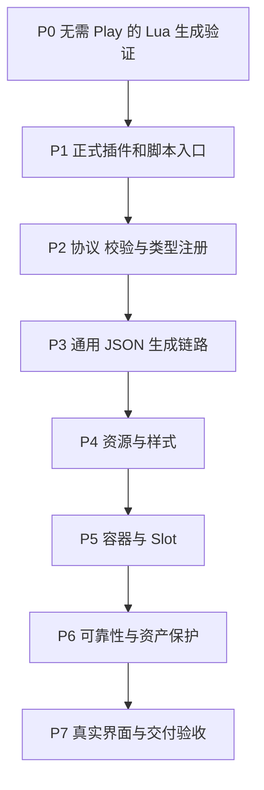

# AutoBlueprint Lua 开发路线图草案

采用 Lua + UnLua + C++ Editor 模块，在 ProjectOne 内开发 AutoBlueprint 插件。首个里程碑是在不启动 Play 的普通编辑状态下，通过 Lua 调用 C++ 创建 Widget Blueprint，编译保存后在新编辑器会话中重新打开。此后逐步补齐资源、布局、控件和交付验证。

版本：0.2 草案；日期：2026-10-30。目标环境：UE 5.3.2、UnLua 2.3.6、Win64 Editor。当前状态：方案与文档阶段，P0 至 P7 均待开发、待实际验证。

依据：[架构设计草案](Architecture.md)、[编码规范 Constitution](constitution.md)。仓库源文件位于 `Plugins/AutoBlueprint/Docs/plan.md`，与架构设计和编码规范放在同一目录。

## 1 目标与首版范围

生成过程使用统一布局 JSON；Lua 负责工具编排，C++ 负责文件读取、最终校验、资源解析、控件树、蓝图编译与保存。生成资产位于 `/Game/UI/...`，插件位于 `ProjectOne/Plugins/AutoBlueprint/`，不要求 PythonScriptPlugin。

| 首版包含 | 后续独立能力 |
| --- | --- |
| 独立编辑器 Lua 环境、工具执行入口、C++ 反射门面 | 无人值守的 UE 命令行 Lua 宿主与批处理退出码适配 |
| 布局 JSON、Schema、校验与结构化结果 | 插件内部接入 AI 识图 |
| 原生 UserWidget 控件树、变量、贴图、布局和静态样式 | 业务事件的 UnLua 绑定、动画、Event Graph 自动生成 |
| CreateOnly：同名资产报告冲突 | 覆盖重建、保留人工逻辑的增量更新 |
| 架构约定的基础 UMG 控件 | ScrollBox、ListView 等更多控件 |

首版控件为 CanvasPanel、Overlay、HorizontalBox、VerticalBox、Border、SizeBox、ScaleBox、Button、Image、TextBlock、Spacer。按钮支持 Normal、Hovered、Pressed、Disabled；自定义 Focused 画刷属于显式不支持项。编辑器生成使用 Lua，不自动为生成界面绑定游戏 Lua 逻辑。

## 2 里程碑顺序

每阶段同步验证本阶段功能，P6 再检查组合场景和失败恢复。前期接口以最小可用实现起步，后续完善同一套主流程；不维护两套独立生成器。

## P0 验证无需 Play 的 Lua 生成链路

先证明新技术路线可行，再扩大控件范围。该阶段包含验证所需的最小项目 Editor 模块、Lua 宿主和反射入口，其可复用代码在 P1 完善为正式框架。

开发任务：

- 确认项目和工具链可在 UE 5.3.2 编译，核验现有 UnLua 模块及公开执行接口。
- 在编辑器主线程创建工具专用 UnLua 环境，不依赖游戏 BeginPlay 或全局启用游戏 Lua。
- 从插件工具目录加载 Lua，调用 C++ 反射函数，验证参数、USTRUCT 返回值、布尔字段和错误传递。
- 使用固定的最小测试输入生成 Canvas、TextBlock、Button，显式设置控件变量并执行编译、保存。
- 关闭编辑器后重开，检查控件、变量和文本仍存在；验证测试不依赖预览实例。
- 测试资产放在 `/Game/UI/AutoBlueprintTests/`，每次使用明确的新名称，不隐式覆盖旧资产。

交付：最小验证源码、Lua 示例、测试布局或固定输入，以及 UE 实际验证记录。

通过条件：正常编辑状态下无需 Play，Lua → C++ → WidgetTree → 编译 → 保存 → 新会话重开的完整链路成功。仅 Lua 打印日志、调用空函数或只生成一个文件，均不能视为通过。

环境条件：当前云端缺少 UE Editor，允许先准备代码、协议和文档，并将 UE 验证标为待完成。若技术验证遇到问题，优先调整编辑器宿主初始化或反射门面，记录问题，不以临时改回 Python 或依赖 Play 代替该目标。

## P1 完善插件与编辑器 Lua 入口

开发任务：

- 完善 `AutoBlueprint.uplugin`、`AutoBlueprintEditor.Build.cs` 与项目启用说明，声明 UnLua 依赖及 Editor 边界。
- 实现 EditorLuaRunner：任务专用环境、受控加载路径、异常收集和结束清理。
- 提供编辑器菜单或明确的工具命令入口，调用子系统与静态 UFUNCTION 门面。
- 建立 Lua 工具 API 和 `generate_from_file.lua`；脚本放在插件 `Scripts/Lua/`，不放入随游戏分发的项目 `Content/Script/`。
- 禁止在 PIE/SIE 期间写资产；明确主线程、重复执行与模块关闭行为。

交付：正式插件骨架、编辑器执行入口、Lua 加载和调用封装、可定位的宿主诊断。

通过条件：开启项目即可使用工具入口；无需 Play；脚本异常有位置/调用栈；任务结束后环境和引用释放；既有游戏 Lua 的启动及状态未被工具流程改变。

## P2 实现协议 校验与控件扩展入口

开发任务：

- 编写 `layout.schema.json`，继续使用 `schema_version: 1`，明确字段、默认值、坐标和颜色单位。
- 解析为内部类型化布局数据，实现版本、名称唯一性、父子数量、Slot、属性、资源引用和路径边界检查。
- 建立控件类型注册与处理器入口，区分叶子、单子节点容器、普通面板和未来的数据驱动控件。
- 实现只读预检及稳定错误码，核验未保存同名包/对象与磁盘资产冲突。
- 固定 C++/Lua 契约：反射字段保留 `bSuccess` 等名称；JSON 和报告使用各自约定的 `lower_snake_case` 字段。

交付：Schema、解析器、校验器、类型注册框架、诊断类型与有效/无效样例。

通过条件：有效配置可解析；错误定位到字段或控件；未知能力明确拒绝；预检不创建、导入或保存资产。新增控件有集中登记入口，但此阶段不实现 ScrollBox 或 ListView。

## P3 完成通用 JSON 生成与持久化

把 P0 的最小验证接入统一配置和正式处理器，形成可供任意受支持布局复用的生成链路。

开发任务：

- 通过 Lua 的 `ValidateLayoutFile` 和 `BuildFromLayoutFile` 门面读取布局文件，再委托 C++ 核心。
- 构建唯一根节点、控件名称、变量开关和合法父子关系，首先覆盖 Canvas、TextBlock、Button。
- 设置基本 Slot 和属性，标记结构变更、编译并检查诊断，再保存必要包。
- 对所有写入入口应用 CreateOnly；编译失败不保存目标 Widget，逐包收集保存结果。
- 输出结构化生成报告，验证普通失败不会被 Lua 封装吞掉。

交付：完整的 JSON → Lua/C++ → `.uasset` 链路及最小布局样例。

通过条件：配置中的层级、位置、文字和变量与 Designer 一致；保存后新会话重开仍正确；同名生成停止且原资产不变。

## P4 加入资源与常用样式

开发任务：

- 支持复用已有 Texture2D、从指定 PNG/JPG 导入新纹理，分别处理源文件、包名与对象路径。
- 检查文件、LFS 内容、资产类型和命名冲突，默认不覆盖或重导入共享纹理。
- 支持 Image 画刷、线性颜色、透明度、Image/Box 绘制与九宫格边距。
- 支持文字字号、已有字体资产、颜色、对齐和换行；中文需核验目标字形。
- 支持按钮四种常规状态；自定义焦点画刷返回明确的不支持诊断。

交付：资源解析器、图片与文字样式处理、按钮状态样例、资源冲突说明。

通过条件：实际贴图与样式生成正确，保存后引用持久化；缺图和错误类型可定位；复用资源的既有设置不变。

## P5 补齐基础容器与 Slot

开发任务：

- 完成 Overlay、HorizontalBox、VerticalBox、Border、SizeBox、ScaleBox、Spacer 等约定控件。
- 按父容器应用 Padding、Alignment、SizeRule、Fill 等受支持属性。
- 补齐 Canvas 锚点、偏移、自动尺寸和层级，维持配置的子节点顺序。
- 用多层嵌套布局验证属性持久化，并维护每种控件的能力表。
- 保留独立的数据驱动处理策略接入点，避免将未来 ListView 当作普通 AddChild 面板。

交付：首版完整控件能力、属性/Slot 映射、嵌套布局示例与对应验证。

通过条件：11 类约定控件的支持矩阵与实现一致，容器使用正确 Slot，非法父子结构被拒绝，保存重开后布局保持正确。

## P6 验证可靠性 环境隔离与资产保护

| 场景 | 预期结果 |
| --- | --- |
| 目标 Widget 已存在，或有同名未保存包/对象 | 冲突返回，原对象与磁盘内容不被覆盖 |
| 资源缺失、LFS 指针、错误资源类型 | 报告具体资源与配置位置 |
| 名称重复、无效 Slot、未知控件或属性 | 明确拒绝，不静默替换或忽略 |
| Lua 环境初始化失败或脚本抛错 | 宿主返回失败，并记录脚本位置与调用栈 |
| Lua 脚本在前面的生成已保存后再抛错 | 区分脚本结果与各次构建结果，如实列出已保存资产，不声称全部回滚 |
| 编译或部分包保存失败 | 不保存编译失败的 Widget，列明已保存和未保存结果 |
| 连续运行、重试、关闭工具或模块 | 无跨任务状态污染，Lua 环境、引用和回调得到清理 |
| PIE/SIE 期间请求写入 | 明确拒绝，工具不借用游戏环境生成 |
| 项目已有游戏 Lua 启动与工具入口分别运行 | 无全局启停或默认启动模块带来的干扰 |

交付：有意义的校验、持久化和失败场景测试；Lua 生命周期与反射结果测试；问题修复和验证记录。

通过条件：关键失败可复现并定位，结果与实际落盘一致，未隐式修改用户资产或共享资源。GC、主线程和模块依赖边界检查通过。测试不以 `.uasset` 字节完全一致作为判断标准。

## P7 真实界面试用与首版交付

开发任务：

- 使用用户提供的完整效果图，明确设计尺寸、目标视口、字体、文字和贴图映射。
- 整理布局 JSON，通过 Lua 工具生成新名称的审阅资产，对照层级、位置、文字、贴图、遮挡及点击区域。
- 在新编辑器会话重新打开，验证变量访问、CreateWidget 与 AddToViewport。
- 检查生成资产不引用 AutoBlueprintEditor 或编辑器 Lua 环境，并完成相关 cook/打包验证。
- 完成安装、Lua 调用、配置、控件能力、错误排查、限制和验收说明；明确命令行 Lua 宿主仍是后续适配。

交付：真实界面的配置与审阅资产、插件源码与 Lua SDK、Schema、样例、测试、使用文档和实际验证记录。

通过条件：达到约定视觉和结构标准，资产可编辑、重新加载和在游戏中显示；项目打包所需资源与类型依赖有效。尚未收到完整效果图时，可先完成标准样例验证，真实界面视觉验收保留为待完成项。

## 3 扩展顺序与接口约束

后续优先增加 ScrollBox，验证普通容器扩展方式；再增加 ListView，独立设计数据项对象、Entry Widget Class、`IUserObjectListEntry`、条目复用与刷新。业务 UnLua 绑定、动画、自定义焦点效果、覆盖重建及增量更新分别定义范围和验收，不混入首版。

新增控件应扩展类型登记、属性/Slot/子节点策略、校验、能力说明与测试。C++ 核心不依赖 Lua 文件的具体写法；Lua 通过门面调用，布局 JSON 继续共用同一协议。

## 4 完成标准与状态记录

每阶段分别记录实现状态和 UE 验证状态：待开发、开发中、实现完成但 UE 验证待完成、验证通过。缺少 UE 环境时可进行代码和文档工作，但不能把静态检查等同于资产生成可用，也不能据此宣布 P0 或首版验收通过。

- [ ] 无需 Play 的 Lua → C++ → Widget Blueprint 生成、保存与新会话重开通过。
- [ ] Lua 工具环境与游戏环境隔离，异常、连续任务及清理通过。
- [ ] 配置协议、反射门面、控件能力、示例和实现一致。
- [ ] CreateOnly、资源复用和失败报告符合实际资产状态。
- [ ] 首版控件、布局、字体与贴图在约定视口中符合目标。
- [ ] 运行时实例化与相关 cook/打包验证完成。
- [ ] 文档列出实际完成的检查、未验证项和已知限制。

每次阶段交付说明包含变更内容、原因、相关文件、实际执行的验证、结果和仍待完成的检查。本轮只更新方案文档，尚未开始 P0 代码实现。

## 修订记录

| 版本 | 日期 | 内容 |
| --- | --- | --- |
| 0.2 草案 | 2026-10-30 | 采用 Lua/UnLua 入口，优先验证无需 Play 的编辑器资产生成；重排 P0 至 P7 路线、交付和验收 |
